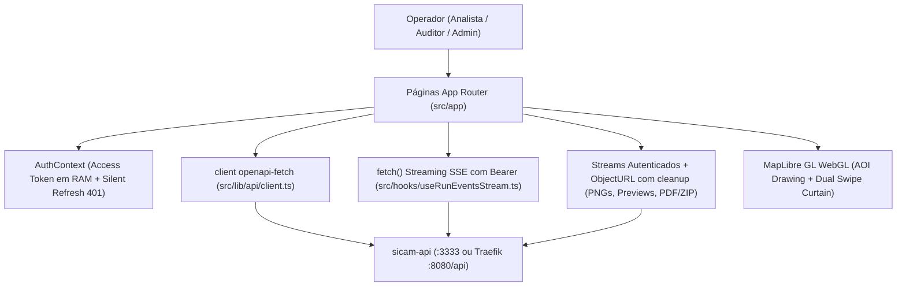

# SICAM Front — Estação WebGIS Institucional

> **Interface Web App (Next.js 15 + MapLibre GL WebGL) do Sistema de Carta-Imagem e Análise Multitemporal.**

O **`sicam-front`** é o cliente web oficial do ecossistema **SICAM**. Ele fornece aos perfis **Analista**, **Auditor** e **Administrador** um ambiente completo no navegador para delimitar Áreas de Interesse (AOIs), buscar imagens Sentinel-2 L2A com medição real de nuvens, acompanhar o processamento por streaming SSE, auditar polígonos sobre cortina interativa *Antes/Depois* ($T_0 \times T_1$), emitir Cartas-Imagem **A3/A4** congeladas (`FROZEN`) e verificar a autenticidade criptográfica SHA-256 de documentos emitidos.

> **Quer um tutorial direto de como usar cada tela sem jargão técnico?** Acesse o [**Manual de Uso em Linguagem Natural (`docs/PASSO_A_PASSO_USUARIO.md`)**](./docs/PASSO_A_PASSO_USUARIO.md).

---

## Sumário

- [1. Natureza e Propósito](#1-natureza-e-propósito)
- [2. Arquitetura, Segurança e Funcionamento](#2-arquitetura-segurança-e-funcionamento)
  - [2.1 Fluxo de Integração no Navegador](#21-fluxo-de-integração-no-navegador)
  - [2.2 Segurança Zero Trust em Memória (RAM)](#22-segurança-zero-trust-em-memória-ram)
  - [2.3 Motor Geodésico Local e Visualização MapLibre GL](#23-motor-geodésico-local-e-visualização-maplibre-gl)
  - [2.4 Matriz de Rotas e Perfis (RBAC)](#24-matriz-de-rotas-e-perfis-rbac)
- [3. Pré-requisitos e Configuração](#3-pré-requisitos-e-configuração)
- [4. Como Executar e Utilizar](#4-como-executar-e-utilizar)
  - [4.1 Execução Local em Desenvolvimento (`pnpm dev`)](#41-execução-local-em-desenvolvimento-pnpm-dev)
  - [4.2 Build Standalone de Produção (`pnpm build` + `pnpm start`)](#42-build-standalone-de-produção-pnpm-build--pnpm-start)
  - [4.3 Execução Containerizada (`Dockerfile` + `docker-compose.yml`)](#43-execução-containerizada-dockerfile--docker-composeyml)
- [5. Sincronização do Contrato OpenAPI 3.1 (`pnpm api:sync`)](#5-sincronização-do-contrato-openapi-31-pnpm-apisync)
- [6. Scripts Disponíveis e Suíte de Testes](#6-scripts-disponíveis-e-suíte-de-testes)

---

## 1. Natureza e Propósito

Desenvolvido como repositório isolado (`polyrepo`) em **Next.js 15 (`output: 'standalone'`)**, **React 19**, **TypeScript estrito** e **Tailwind CSS**, o `sicam-front` foi desenhado para operar com segurança institucional e alta fidelidade espacial:

- **Contrato 100% Tipado com a API:** Todas as requisições utilizam `openapi-fetch` alimentado por tipos gerados automaticamente a partir do `openapi/openapi.v1.json` do `sicam-api`.
- **Zero Credenciais Persistidas no Navegador:** Nenhum Access Token é gravado em `localStorage`, `sessionStorage` ou cookies acessíveis via JavaScript.
- **Mapas WebGL de Alta Performance:** Desenho interativo de polígonos AOI e cortina dupla sincronizada (*Before/After Swipe*) construídos com `maplibre-gl` e cálculos geodésicos locais em **SIRGAS 2000 / GRS80** (`src/lib/geo/aoiGeometry.ts`).

---

## 2. Arquitetura, Segurança e Funcionamento

### 2.1 Fluxo de Integração no Navegador



### 2.2 Segurança Zero Trust em Memória (RAM)

- **Access Token em RAM (`src/contexts/AuthContext.tsx`):** O JWT EdDSA permanece apenas na memória da aba React. Ao recarregar a página, o app solicita silenciosamente `POST /api/v1/auth/refresh` usando o cookie `HttpOnly` gerenciado pelo backend.
- **Single-Flight 401 Refresh (`src/lib/api/client.ts`):** Múltiplas requisições simultâneas que recebam `401` aguardam uma única chamada de renovação (*mutex*), evitando tempestade de refreshes e falsas revogações por corrida de rede.
- **Downloads, Previews e SSE via `fetch` com `Bearer`:** Em conformidade com a política Zero Trust (sem `?token=` na URL), streams SSE (`/events`), miniaturas STAC (`/scenes/preview`), rasters PNG (`/rasters/:assetType`) e pacotes congelados (`/exports/:exportId/download`) são baixados via `fetch` autenticado e convertidos em `Blob`/`ObjectURL` com revogação determinística no desmontar dos componentes (`URL.revokeObjectURL`).
- **Anti Open Redirect (`src/lib/auth/rbac.ts`):** Parâmetros `?next=` após o login são validados por `sanitizeInternalRedirect` contra URLs externas ou `/login`.

### 2.3 Motor Geodésico Local e Visualização MapLibre GL

- **Projeção Geodésica Client-Side (`src/lib/geo/aoiGeometry.ts`):** Calcula zona UTM (`EPSG:31978`–`31985` / sul-equatorial SIRGAS 2000), área oficial sobre o elipsoide GRS80, perímetro em metros, interseção topológica (sem auto-cruzamento de arestas) e importação/normalização de `.geojson`.
- **Cortina Dupla Sincronizada (`src/components/runs/MultitemporalSwipeMap.tsx`):** Sobrepõe dois mapas MapLibre sincronizados ($T_0$ vs $T_1$) com modos *Cor Natural (RGB)*, *Falsa-Cor (NIR)*, *Máscara $\Delta\text{NDVI}$ + SCL* com opacidade ajustável, camada vetorial clicável e alternância de mapa-base (OSM, Satélite/Ortoimagem e Escuro Técnico).

### 2.4 Matriz de Rotas e Perfis (RBAC)

| Rota | Menu na Barra | Perfis Permitidos | Finalidade |
| :--- | :--- | :--- | :--- |
| `/login` | — | Público | Autenticação institucional com e-mail e senha. |
| `/cases` | `Casos & Cartas-Imagem` | `analyst`, `auditor`, `admin` | Consulta espacial, filtros, mapa geral de AOIs e histórico de versões. |
| `/cases/new` | *(botão na lista de casos)* | `analyst` | Criação de Caso, busca de município IBGE e desenho/upload de AOI. |
| `/cases/[caseId]` | *(detalhe do caso)* | `analyst`, `auditor`, `admin` | Ficha geodésica imutável, edição de metadados textuais (`analyst`) e versões `v1..vN`. |
| `/cases/[caseId]/analysis/new` | *(fluxo do caso)* | `analyst` | Busca STAC $T_0/T_1$, miniaturas, alerta de sazonalidade e seleção de preset espectral. |
| `/cases/[caseId]/runs/[runId]` | *(execução do caso)* | `analyst`, `auditor`, `admin` | Progresso SSE ao vivo, cortina $T_0 \times T_1$, curadoria de feições (`analyst`), emissão A3/A4 e downloads `FROZEN`. |
| `/integrity` | `Verificar Integridade` | `analyst`, `auditor`, `admin` | Verificação SHA-256 por hash hexadecimal ou upload streaming de `.pdf`/`.zip` (até 100 MB). |
| `/audit-logs` | `Trilha de Auditoria` | `admin`, `auditor` | Consulta paginada por cursor (`keyset`) da trilha *append-only*. |
| `/admin/users` | `Operadores & Perfis` | `admin` | Cadastro, alteração de perfil e bloqueio imediato de operadores. |

---

## 3. Pré-requisitos e Configuração

- **Node.js `>= 22.0.0`** e **pnpm `9.7.0`**
- Instância em execução do **`sicam-api`** (padrão `http://localhost:3333`)

Crie `.env.local` a partir do `.env.example`:

```bash
cp .env.example .env.local
```

Variáveis disponíveis (`.env.example` / `src/config/env.ts` / `scripts/syncOpenApi.mjs`):

| Variável | Padrão | Uso |
| :--- | :--- | :--- |
| `NEXT_PUBLIC_API_BASE_URL` | `http://localhost:3333` | URL base da API consumida no navegador. Deixe vazio (`""`) **apenas** quando servido atrás do reverse proxy Traefik v3 sob a mesma origem. **Importante:** por ser `NEXT_PUBLIC_*`, é injetada no momento do `next build`. |
| `OPENAPI_SPEC_URL` | *(opcional)* | URL da spec OpenAPI 3.1 viva (ex.: `http://localhost:3333/docs/openapi.json`) usada por `pnpm api:sync`. |
| `OPENAPI_SPEC_PATH` | `../sicam-api/openapi/openapi.v1.json` *(fallback)* | Caminho local alternativo do `openapi.v1.json` usado por `pnpm api:sync`. |

---

## 4. Como Executar e Utilizar

### 4.1 Execução Local em Desenvolvimento (`pnpm dev`)

```bash
corepack enable
pnpm install --frozen-lockfile
cp .env.example .env.local

# Opcional: atualizar tipagem OpenAPI a partir do sicam-api
pnpm api:sync

# Iniciar servidor Next.js na porta 5173
pnpm dev
```

Acesse `http://localhost:5173` (certifique-se de que `FRONTEND_ORIGIN=http://localhost:5173` esteja configurado no `.env` do `sicam-api`).

### 4.2 Build Standalone de Produção (`pnpm build` + `pnpm start`)

```bash
pnpm typecheck
pnpm build
pnpm start
```

O Next.js compila o artefato enxuto em `.next/standalone` e inicia o servidor na porta `5173`.

### 4.3 Execução Containerizada (`Dockerfile` + `docker-compose.yml`)

O `Dockerfile` multi-stage (`node:22-alpine`) gera o build `standalone`, roda como usuário não-root `nextjs` (`uid 1001`) na porta `5173` e inclui `HEALTHCHECK` nativo em `/login`.

Como o `NEXT_PUBLIC_API_BASE_URL` é incorporado durante o build pelo Next.js, o `docker-compose.yml` expõe esse valor como `build.args`:

```bash
# Modo standalone padrão (navegador acessa API em http://localhost:3333)
docker compose up -d --build

# Ou publicando atrás do Traefik v3 na mesma origem (ex.: http://localhost:8080)
NEXT_PUBLIC_API_BASE_URL="" docker compose up -d --build
```

Para parar o container:

```bash
docker compose down
```

---

## 5. Sincronização do Contrato OpenAPI 3.1 (`pnpm api:sync`)

O script `scripts/syncOpenApi.mjs` resolve a especificação nesta ordem de prioridade:
1. `OPENAPI_SPEC_URL` (HTTP GET se definido);
2. `OPENAPI_SPEC_PATH` ou o arquivo irmão `../sicam-api/openapi/openapi.v1.json`;
3. O snapshot versionado local em `openapi/openapi.v1.json` (usado automaticamente em builds Docker isolados).

Em seguida, gera os tipos estritos em `src/types/generated/openapi.d.ts`:

```bash
pnpm api:sync
```

---

## 6. Scripts Disponíveis e Suíte de Testes

| Comando | Descrição |
| :--- | :--- |
| `pnpm dev` | Servidor de desenvolvimento Next.js na porta `5173`. |
| `pnpm build` | Build de produção (`output: 'standalone'`). |
| `pnpm start` | Executa o build de produção na porta `5173`. |
| `pnpm typecheck` | Checagem estrita TypeScript (`tsc --noEmit`). |
| `pnpm test` | Executa todos os testes Vitest (autenticação, RBAC, cliente OpenAPI, geodésia AOI, STAC/sazonalidade, SSE parser, curadoria e exportação). |
| `pnpm test:watch` | Executa Vitest em modo interativo. |
| `pnpm api:sync` | Sincroniza `openapi/openapi.v1.json` e regenera `src/types/generated/openapi.d.ts`. |

Verificação completa antes de publicar alterações:

```bash
pnpm typecheck && pnpm test && pnpm build
```
